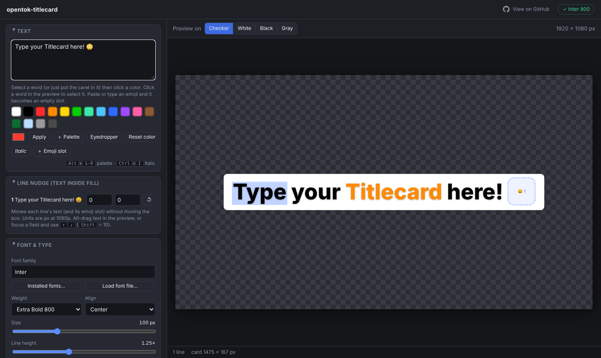

# OpenTitlecard

**Open-source titlecards for social video.** TikTok and Instagram-style titlecards as transparent PNGs, straight from your browser. No fussy plugins to install needed!



Type a line of text, color individual words, and export a transparent PNG with the familiar rounded-box look, ready to drop into Premiere Pro, After Effects, DaVinci Resolve, CapCut, or any editor that reads PNGs.

Unlike title-card tools built for TV episodes, movies or lower thirds, this one is made for short-form social video.

It's a single HTML file. There's nothing to install, nothing to build, and nothing is uploaded anywhere: everything runs locally in your browser.

**Live app:** <https://wishym1shy.github.io/opentitlecard/>

## Why this exists

Paid plugins and MOGRTs can make this style of caption, but:

- **Emoji break.** Paste a titlecard with an emoji into an Adobe text layer and the emoji turns black-and-white and hollow, because Adobe's text engine doesn't render color emoji fonts.
- **One color per card.** Most templates only let you color the whole text block, not a single word.
- **Everyone needs the plugin.** Every editor has to install it, license it, and keep it updated.

OpenTitlecard fixes each of those. Emoji get a correctly-sized **slot**: leave it empty to paste your own color emoji on top in your editor, or put an image of your own in it. Any word can have its own color.

## Features

- **Per-word color, bold, italic and underline.** The **B / I / U** bar above **Font family** (or **Ctrl+B / I / U**, **⌘** on a Mac) formats the selected letters, or the word at the caret, just like a swatch colors them. Bold is the next weight up (Regular becomes Bold, Bold becomes Black), using the font's real Bold face where it has one. If a font has no italic face, or no bolder face, the app still fakes it but shows a ⚠ by the bar (hover it for why) and a short note at the bottom the first time. Put the caret in a word (or select a range) and click a swatch. Click any word in the preview to select it; click it again on its punctuation to select just that (say, a black "!" after a red word). Includes a palette, custom colors, and an eyedropper.
- **Emoji slots.** Type or paste an emoji and it becomes a slot in the layout. The background box wraps around it exactly as it would around the real thing. The slot is outlined in the preview only, never in the export. It stays empty until you put an image on it. Each emoji slot has its own **Scale X** and **Scale Y** (under Titlecard Properties › Emoji Slot) to set exactly how much room it takes, sideways and up and down; a picture's own size is separate, so emoji can be sized alike and spaced differently.
- **Your own emoji images.** The **Emoji** panel keeps images you add (PNG, WebP or SVG: drop them, choose them or paste one), shrunk and trimmed, in your browser on your computer. Click a slot in the preview, then an image, and it fills the slot in the preview and in the PNG, without changing the card's layout; make an image the default for an emoji to fill every slot of it. Each slot has its own X, Y and Size for the picture, with guides for the centre, capital height and baseline, a **Match cap height** and a **Sit on baseline** shortcut, and a way to copy a placement to every slot that shows the same image. **Leave emoji slots empty** (in Export) keeps them out of the PNG if you paste your own on top instead. OpenTitlecard comes with no emoji images and never uploads yours; use only images you have the right to use.
- **Smart background box.** Each line gets its own rounded box, with inverse corners where line widths differ, like TikTok's own captions. The box grows downward automatically when descenders (`g`, `y`, `p`, `q`, `j`) or an emoji would crowd the bottom edge.
- **Optional auto-wrap.** Set a **Max card width** and long lines wrap at spaces to fit, with the padding included. Your own line breaks always win, and color, italic and emoji slots carry through the wrap.
- **Stretch and squish.** Scale the letters wider or narrower, taller or shorter (50–200%) to play with the shape of any font. The box follows the letters with the same padding, and emoji slots stay square.
- **Text position (line nudge).** Fine-tune the X/Y position of each line's text inside its box with Premiere-style controls: a slider per axis that rests at 0 in the middle (left = negative, right = positive, +Y is down), a number field, and a draggable **X**/**Y** label to scrub. Arrow keys step by 1 (**Shift** = 10), double-click resets an axis, and **Alt**-drag a line in the preview works too.
- **Bring your own font.** Pick any installed font, or load a `.ttf`, `.otf`, `.woff` or `.woff2` file for a client's brand font. A font file you load is remembered in your browser, so it's there next time, even if you move or delete the original. If a font isn't available (say, on another computer), a ⚠ in the family box says so and offers **Reset to Inter (default)**.
- **Background control.** Color, opacity, padding, corner radius, top/bottom margins, and optional soft shadows. Text outline and text shadow are available too.
- **One-click resets.** Scale and every Text Settings and Background slider have a ↺ button (or double-click the slider) that puts it back to its default.
- **Transparent PNG export.** Full-frame at 1920×1080, 1080×1920, 3840×2160, 2160×3840, 1080×1080, 1080×1350 or a custom size, or a tight crop of just the card at up to 4×. **Landscape / Vertical** flips the canvas in one click. Exports are limited to 3840 px (4K) on each side.
- **Card names.** Cards are named like layers (Titlecard 1, Titlecard 2…); double-click one to rename it. Paste two columns from a spreadsheet into **Add from list** (a name, then the text) and each card takes its name from the first column. Use `{name}` in the export file name pattern, or click **Name files after the cards**, and every PNG is named after its card.
- **Export a whole set.** Add several cards (or paste a list of titles), then **Export all N as ZIP…** in the Export panel (right under **Download PNG**) opens a preview of every card, lets you set the canvas (size, custom size, tight crop and scale, card position), apply a preset to the whole set, and set a file name pattern (by default `{set}-{n}`, so the PNGs and the ZIP are named after your set; `ClientA-Vid{n}-TC` style patterns work too, with first number and zero-padding), and downloads one transparent PNG per card in a single ZIP. Click any thumbnail to preview that card at full size and flip through the set with ← →. Cards share one style (font, colors, box) unless a card is given its own (◆); text, per-word color, italic and line nudges are always per card. **Apply preset to all cards** restyles the whole set (after asking you to confirm).
- **Save and open sets.** Your cards are a **set**, named in the box at the top right (*Untitled set* until you name it). The **☰ File** menu next to it has **Save set** (**Ctrl+S**, **⌘S** on a Mac), **Save set as…** (**Ctrl+Shift+S**) and **Open set…** (**Ctrl+O**); you can also drop a set file anywhere on the page to open it. A set is saved as a `.opntcd` file named after the set, holding the text, per-word colors, italics, nudges and styles (it is plain JSON inside, readable in any text editor). In Chrome and Edge, the first Save asks where to put the file and later Saves update that same file, like a desktop app; other browsers download a new copy each time. Sets saved earlier as `.json` still open. **New set** (in the File menu, or the icon above the card list) starts over. Opening and New set ask before replacing cards you haven't saved (a fresh page doesn't ask). Nothing about your cards is kept in the browser. Double-clicking a `.opntcd` file doesn't open the app: open it from the app instead.
- **Undo and redo.** **Ctrl+Z** / **Ctrl+Shift+Z** (or **Ctrl+Y**; **⌘Z** / **⌘⇧Z** on a Mac), or the buttons above the preview, step back and forward through text, colors, styles, nudges and card changes, including *New set* and *Open set…*. A burst of typing or one slider drag is a single step. The last 100 steps are kept while the page is open.
- **A tidy first screen.** The page opens on the text: the card's look (Position, Text Position, Text Settings, Background, Emoji Slot) sits folded under **Titlecard Properties**, and only the Cards panel is open on the right.
- **Presets.** Save a style (font, colors, sizes) per client, and export or import it as a `.json` file from the **☰ File** menu. Mark one as the **default** (★) and the app starts with it the first time it opens (before any settings are saved); after that your last-used settings come back, and **Load** returns to any preset.

## Layout

The version is shown next to the name at the top left; see [CHANGELOG.md](CHANGELOG.md) for what changed in each one.


The design controls are on the left: **Text** at the top (with the font family, weight and size), **Presets** at the bottom, and everything about the card's look in between under **Titlecard Properties** (Position, Text Position, Text Settings, Background, Emoji Slot), folded when the page opens. **Cards**, **Canvas** and **Mock-up & safe zone** float at the top right of the preview, and **Export** sits by itself at the bottom right: click a panel's title to minimize or expand it (every visit starts with only Cards open), or use **Panels** in the toolbar to hide them all and give the preview the whole width. The app remembers whether the panels are hidden.

**Zoom and pan:** **Ctrl+scroll** (⌘+scroll on a Mac, or pinch on a trackpad) zooms around the cursor; scroll to move around, **Shift+scroll** sideways, or drag with **Space** held or the middle mouse button. The zoom bar at the bottom-left of the preview has −/+, **Fit** and **100%** (actual size); **Ctrl+=**, **Ctrl+−** and **Ctrl+0** do the same. 100% shows one canvas pixel per screen pixel, so past that you see the real export pixels.

## Mock-up background

To see how a card will look on the real video, load a frame of the footage (or a screenshot of the feed) with **Load image…** under **Mock-up background**, at the top of the **Mock-up & safe zone** panel. It is drawn behind the card and fills the canvas the way the video would; **Position X / Y**, **Scale** and **Opacity** adjust it, and **↺** resets each one. Like the safe zone, it is only drawn on the preview: the PNG stays transparent. The settings are remembered; the image is kept until you reload the page. The safe zone can be shown on top of the mock-up, or either one on its own.

## Safe zones

Turn on **Show safe zone/overlay** (under **Safe zone & overlay**) in the **Mock-up & safe zone** panel to see where a platform's interface covers your video. **Stories** and **Reels** (9:16) shade the interface bars red (250 px at the top and bottom of a 1080 × 1920 frame, plus the side buttons in Reels) and the safe zone green, and the bottom bar tells you whether the card in front is inside it or which part it runs into. **Instagram Reels UI | iPhone 16 Pro** draws the whole Reels screen instead (tabs, side buttons, creator and caption, navigation bar, the phone's rounded corners, Dynamic Island and home indicator, plus a grey "9x16 video" area: on iPhone the video fills the screen from the very top down to the navigation bar, so a little of each side is cropped, and the overlay tells you how much) at 1206 × 2622, the size of the **iPhone 16 Pro** canvas preset, so a mock-up background, your card and the interface together show the finished post. You can also load **your own image** (PNG, JPG, WebP or SVG) as the overlay. **X / Y offset** and **Scale** move and resize it, **Opacity** fades it; type a value, drag the field's icon, or double-click the icon to reset. The overlay is fitted to the canvas, so it matches exactly on 1080 × 1920 and 2160 × 3840. It is only drawn on the preview: it is **never exported**. The settings are remembered; a loaded image is kept until you reload the page.

## Quick start

1. Open the live app, or download [`index.html`](index.html) and open it in **Chrome or Edge**.
2. Type your text. Press **Enter** for a new line.
3. Select a word and click a color. Add an emoji anywhere to reserve a slot.
4. Click **Download PNG**. Making a set? Add more cards and use **Export all as ZIP…** instead.

### Using it in Premiere Pro (or any editor)

1. Export a **full-frame** PNG that matches your sequence size.
2. Drag the PNG onto the timeline. It keeps its transparency.
3. Paste your emoji image on top. The **Emoji Slot** section (under **Titlecard Properties**) lists each slot's size in pixels and the **Position** to type into the Motion/Transform controls, assuming the PNG sits at its default position and 100% scale.

> Tip: if you want the card sized by the editor instead of the canvas, use **Tight crop** and scale the PNG in your editor.

## Fonts

The default font is **Inter** (Bold), a free, open-source typeface (SIL Open Font License 1.1) that works well for this style. Four more open-source families ship with it: **Montserrat** (a geometric sans), **Linik Sans** (a wide, friendly sans based on Inter), **Source Serif 4** and **Playfair Display** (two serifs). Each comes with real upright and italic faces and every weight, and they are embedded in `index.html` (Latin alphabet), so the app looks right on any computer with nothing to install and nothing downloaded. The app always uses its own copy of these for the Latin alphabet, so a card looks and exports the same on every computer, and an installed copy of the same font only fills in characters the bundled one doesn't have (other alphabets).

To use another font:

- open the **Font family** menu (the arrow in the box, or press ↓) to pick one of the included fonts, a font you loaded earlier, or (after **Installed fonts…**) one installed on your computer. Type to filter the list, or type any family name, or
- use **Load font file…** to load fonts from disk (`.ttf`, `.otf`, `.woff`, `.woff2`). Pick all the files of a typeface at once (Regular, Bold, Italic…): OpenTitlecard reads each file's family, weight and italic, so they become one family with a working **Weight** menu and a real italic. For `.woff2` files (which a browser can't read inside) it guesses these from the file name and asks you to check them.

If the selected family isn't available, the app shows a warning and renders with a fallback font, so you know the export won't match the intended look.

The bundled fonts are open source and free to use commercially and non-commercially, and the app never uploads fonts. Their copyright notices and license are kept next to the embedded fonts in `index.html` and in [`THIRD_PARTY_LICENSES.md`](THIRD_PARTY_LICENSES.md). If you fork OpenTitlecard to make something commercial, check the licenses of what you ship yourself.

## Browser support

Use a Chromium browser (Chrome, Edge, Brave, Arc) for the full experience. The app relies on the Canvas API with letter-spacing, `Intl.Segmenter`, and (optionally) the Local Font Access API and EyeDropper API. Firefox and Safari may work for basic use but are not tested.

## Privacy

Everything happens in your browser. No text, fonts, emoji images, or other images leave your computer. The one thing the app fetches is its own page, now and then, to see whether a newer version is out; it sends nothing about you or your work, and when there is one, a green **Update available** pill appears next to the version number. Click it to reload. (Opened as a local file, it never checks.) Your last style settings, custom palette colors, saved presets, your export file-name pattern are stored in your browser's `localStorage` and nowhere else. Font files you load are kept in your browser's IndexedDB on this computer, so they come back next time; **Forget them** under the font buttons removes them. Your cards and their text are **not** stored: they exist only on the page until you save them to a file you choose. The undo history is kept in memory too, and is gone when you close or reload the page. Mock-up and safe zone images you load stay in memory for the session only.

To clear what the app keeps, use the **☰ File** menu. **Soft reset…** puts the settings back to how the app first opens (the card's look, canvas size, overlay, mock-up, export naming, panels and auto-scale) and keeps your presets, palette colors, remembered fonts and emoji library. **Reset all…** deletes everything, presets, remembered fonts and the emoji library included. Both say exactly what they clear before you confirm, and both clear the cards on the page, so save the set first.

## Limitations

- Output is a **flat PNG**: the text is not live or editable once exported. Re-open the app to change it.
- Auto-wrap breaks only at spaces (no hyphenation, no mid-word breaks), and a word wider than the limit keeps its own line. Line nudges are tied to line numbers, so changing the max width can change which text a nudge applies to.
- Cards are not kept anywhere automatically: reloading the page starts over, so use **Save set** (**Ctrl+S**) first. A set file doesn't contain fonts; a font loaded with **Load font file…** has to be loaded again. Cards share one style unless you tick **This card has its own style**; canvas size and crop are always shared by the whole export. The ZIP uses plain (stored) entries, since PNGs are already compressed.
- The app never draws emoji by itself and comes with no emoji images: a slot is empty until you put one of your own images on it, or you paste an emoji on top in your editor. Licensing of the images you add is up to you. A set file names the images a card uses but doesn't contain them, so the same images need to be in the library on the other computer; a missing one shows a warning and leaves the slot empty.

## Development

The app itself has **no build step and no runtime dependencies**: it's just `index.html`. Node is only needed to run the tests.

```bash
# run the app: open index.html, or serve the folder
python3 -m http.server 8000

# run the tests (Playwright + Chromium)
npm ci
npx playwright install chromium
npm test
```

The tests load a pinned open-source font (Inter, via `@fontsource/inter`) through the app's own **Load font file…** feature, so results are identical on any machine. GitHub Actions runs the same suite on every pull request and on every push to `main`.

The page exposes a small hook for tests, `window.__tt`, with the state (`S`), the last layout (`L`), `render()`/`renderNow()`, `exportGeometry()` and `draw()`, plus the batch helpers (`cards`, `active`, `batchNames()`, `buildZip()`, `crc32()`).

Contributions are welcome. Open an issue first for anything big. All changes land through pull requests that the maintainer reviews and merges, and CI must pass.

## License

[MIT](LICENSE)

## Disclaimer

This is an independent project. It isn't affiliated with, endorsed by, or sponsored by TikTok, ByteDance, or Adobe. "TikTok" and "Adobe" are trademarks of their respective owners and are used here only to describe compatibility and the style being recreated.
